# Projektbericht

## Parking Management System

**Veranstaltung:** Objektorientierte Systemanalyse und Entwurf (OSAE)  
**Projekt:** Refaktorisierung des Parkplatz-Management-Systems  
**Stand:** 11. November 2026  
**Repository:** `steppentaucher/parking-management-system`

> Dieses Dokument bildet die Anforderungen aus dem OSAE-Projektbericht auf die
> aktuell implementierte Java-Anwendung ab. Die Diagramme verwenden Mermaid und
> können direkt auf GitHub dargestellt oder in ein UML-Werkzeug übertragen
> werden.

## 1. Einleitung

### 1.1 Vorwort

Das Parking Management System ermöglicht die digitale Verwaltung von
Parkplätzen und Buchungen. Kunden können Parkplätze anhand eines Ortes und
zusätzlicher Ausstattungsmerkmale suchen, Preise für einen Zeitraum ermitteln,
einen Parkplatz buchen und eigene Buchungen stornieren. Betreiber verwalten
ihre Parkplätze, deren Kapazitäten, Preise und Ausstattungsmerkmale.

Die Anwendung wurde als Java-Swing-Anwendung mit einer objektorientierten
Domänenschicht und dateibasierter Persistenz umgesetzt. Dieser Bericht
dokumentiert die Anforderungsanalyse, die fachliche Analyse, das Design, die
Implementierung und die Validierung.

### 1.2 Problemstellung und Motivation

Die manuelle Suche nach Parkmöglichkeiten ist zeitaufwendig. Außerdem müssen
Kapazitäten, Zeitüberschneidungen, unterschiedliche Tarife und die
Berechtigungen verschiedener Nutzergruppen zuverlässig berücksichtigt werden.
Das System bündelt diese Aufgaben in einer zentralen Plattform.

Die OSAE-Arbeit dient zugleich als Refaktorisierung der vorherigen
OOP-Projektlösung. Der Schwerpunkt liegt deshalb nicht auf neuen
Geschäftsfunktionen, sondern auf der nachvollziehbaren Ableitung von
Anforderungen, UML-Modellen und einer konsistenten technischen Struktur.

## 2. Anforderungsanalyse

### 2.1 Stakeholder und Rollen

| Rolle | Ziel |
|---|---|
| Kunde | Parkplätze suchen, Preis prüfen, buchen und eigene Buchungen verwalten |
| Betreiber | Eigene Parkplätze anlegen, bearbeiten, löschen und Belegung einsehen |
| System | Verfügbarkeit, Preise, Berechtigungen und Persistenz sicherstellen |

### 2.2 Funktionale Anforderungen

| ID | Anforderung | Priorität |
|---|---|---|
| FA-01 | Nutzer können sich als Kunde oder Betreiber registrieren. | Muss |
| FA-02 | Nutzer können sich mit ihrer E-Mail-Adresse anmelden und abmelden. | Muss |
| FA-03 | Kunden können Parkplätze nach Ort und Features suchen. | Muss |
| FA-04 | Das System berechnet Preise für normale Tage, Wochenenden und Feiertage. | Muss |
| FA-05 | Kunden können verfügbare Parkplätze für mindestens 15 Minuten buchen. | Muss |
| FA-06 | Kunden können eigene Buchungen stornieren. | Muss |
| FA-07 | Betreiber können Parkplätze anlegen, bearbeiten und löschen. | Muss |
| FA-08 | Gebuchte Parkplätze dürfen nicht gelöscht werden. | Muss |
| FA-09 | Buchungen dürfen sich nur innerhalb der verfügbaren Kapazität überschneiden. | Muss |
| FA-10 | Nutzer-, Parkplatz- und Buchungsdaten werden dauerhaft gespeichert. | Muss |

### 2.3 Nichtfunktionale Anforderungen

| ID | Anforderung |
|---|---|
| NFA-01 | Die Anwendung soll objektorientiert strukturiert und in Model, View und Controller gegliedert sein. |
| NFA-02 | Die GUI soll Kunden und Betreiber abhängig von ihrer Rolle unterschiedliche Funktionen anbieten. |
| NFA-03 | E-Mail-Adressen, Kapazitäten, Preise und Zeiträume werden validiert. |
| NFA-04 | Bestehende Buchungspreise bleiben nach einer späteren Parkplatz-Preisänderung unverändert. |
| NFA-05 | Referenzen zwischen Buchungen, Kunden und Parkplätzen bleiben beim Laden erhalten. |
| NFA-06 | Nicht erlaubte Aktionen werden mit einer fachlich passenden Ausnahme abgelehnt. |

### 2.4 Use-Case-Übersicht

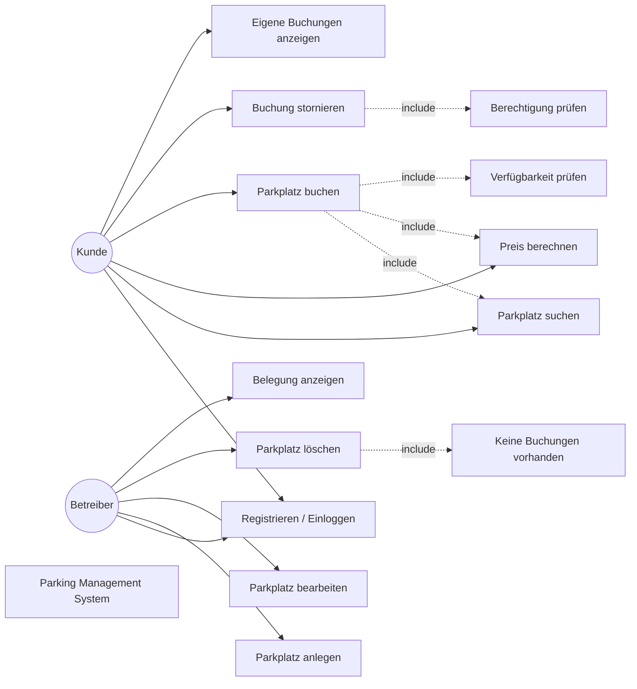

### 2.5 Use-Case-Spezifikationen

#### UC-01: Nutzer registrieren

| Element | Beschreibung |
|---|---|
| Primärakteur | Kunde oder Betreiber |
| Vorbedingung | Die Registrierungsansicht ist geöffnet. |
| Auslöser | Der Nutzer gibt Name, E-Mail und Nutzertyp ein und bestätigt. |
| Hauptszenario | Eingaben prüfen; E-Mail normalisieren; Duplikat prüfen; passende Unterklasse erzeugen; Nutzer speichern. |
| Alternativen | Leerer Name, ungültige E-Mail, unbekannter Typ oder bereits verwendete E-Mail führen zu einer Fehlermeldung. |
| Nachbedingung | Ein neuer `Kunde` oder `Betreiber` ist registriert. |

#### UC-02: Parkplatz suchen

| Element | Beschreibung |
|---|---|
| Primärakteur | Kunde |
| Vorbedingung | Die Kundenansicht ist geöffnet. |
| Auslöser | Ort und/oder Features werden eingegeben. |
| Hauptszenario | Suchtext normalisieren; Parkplatzliste nach Ort und Features filtern; Treffer anzeigen. |
| Alternativen | Leere Filter liefern alle Parkplätze; kein Treffer zeigt eine leere Ergebnisliste. |
| Nachbedingung | Der Kunde erhält eine Liste passender Parkplätze. |

#### UC-03: Parkplatz buchen

| Element | Beschreibung |
|---|---|
| Primärakteur | Kunde |
| Vorbedingung | Ein Kunde ist eingeloggt und ein Parkplatz ausgewählt. |
| Auslöser | Der Kunde wählt Beginn und Ende und bestätigt die Buchung. |
| Hauptszenario | Zeitraum validieren; Mindestdauer prüfen; Überschneidungen zählen; Preis festhalten; Buchung erzeugen; Kunden- und Systemliste aktualisieren. |
| Alternativen | Nicht eingeloggte Nutzer, Betreiber, ungültige Zeiträume, weniger als 15 Minuten oder volle Kapazität werden abgelehnt. |
| Nachbedingung | Eine Buchung mit eindeutiger Buchungsnummer ist gespeichert. |

#### UC-04: Buchung stornieren

| Element | Beschreibung |
|---|---|
| Primärakteur | Kunde |
| Vorbedingung | Der Kunde ist Eigentümer der Buchung. |
| Auslöser | Der Kunde wählt eine eigene Buchung und bestätigt die Stornierung. |
| Hauptszenario | Eigentümer prüfen; Buchung aus der globalen und persönlichen Liste entfernen. |
| Alternative | Eine fremde Buchung führt zu einer `SecurityException`. |
| Nachbedingung | Die Buchung ist nicht mehr aktiv und die Kapazität wieder verfügbar. |

#### UC-05: Parkplatz verwalten

| Element | Beschreibung |
|---|---|
| Primärakteur | Betreiber |
| Vorbedingung | Ein Betreiber ist eingeloggt. |
| Hauptszenario | Parkplatz anlegen, bearbeiten oder löschen; Kapazität und Preise prüfen; bei Löschung Buchungen prüfen. |
| Alternativen | Kunden dürfen die Aktionen nicht ausführen; gebuchte Parkplätze dürfen nicht gelöscht werden. |
| Nachbedingung | Die Parkplatzdaten entsprechen dem bestätigten Änderungswunsch. |

### 2.6 Aktivitätsdiagramm: Buchung

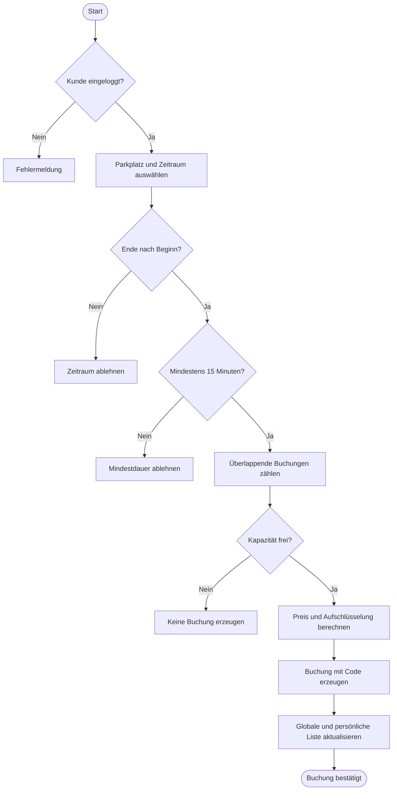

## 3. OO-Analyse (Systemanalyse)

### 3.1 Analyseklassenmodell

Das Analysemodell unterscheidet Entitäten, Steuerung und Benutzeroberfläche.
`PlattformManager` übernimmt die fachliche Steuerung und vermittelt zwischen
Views und den Domänenobjekten. `FileIO` ist für die dauerhafte Speicherung
zuständig.

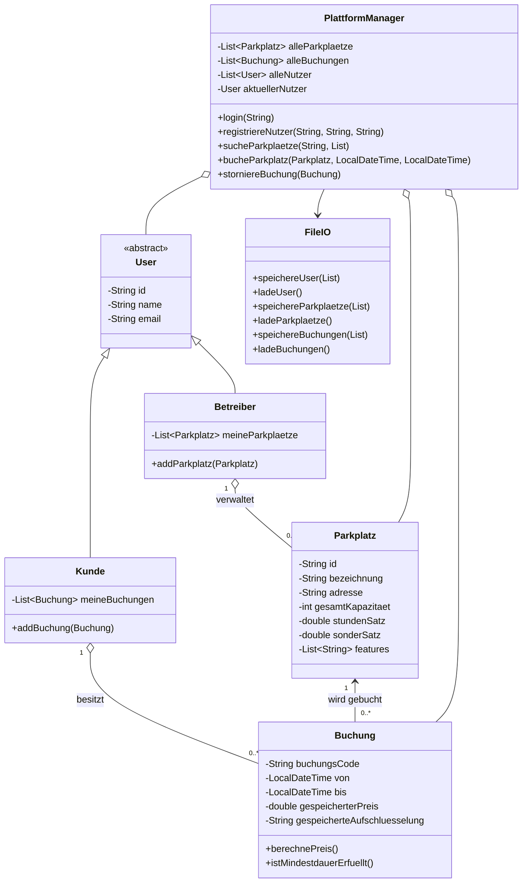

### 3.2 Objektdiagramm: beispielhafter Systemzustand

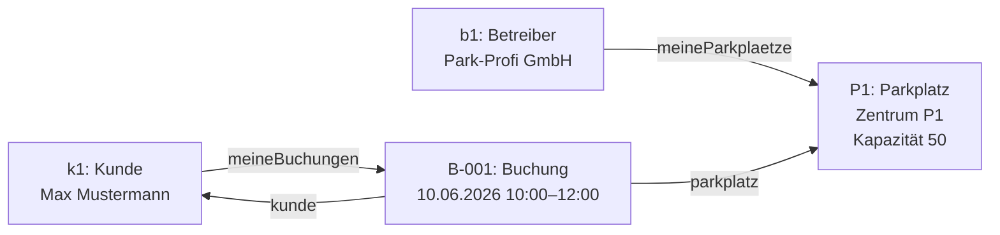

### 3.3 Zustandsdiagramm einer Buchung

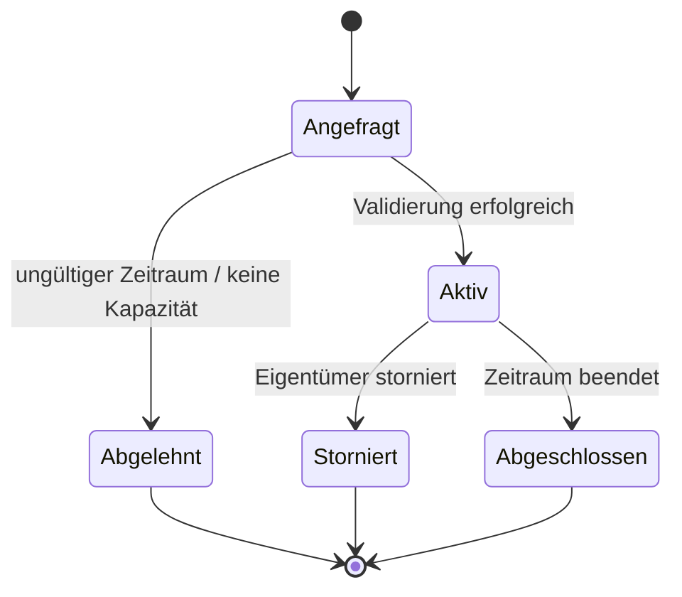

### 3.4 Sequenzdiagramm: Parkplatz buchen

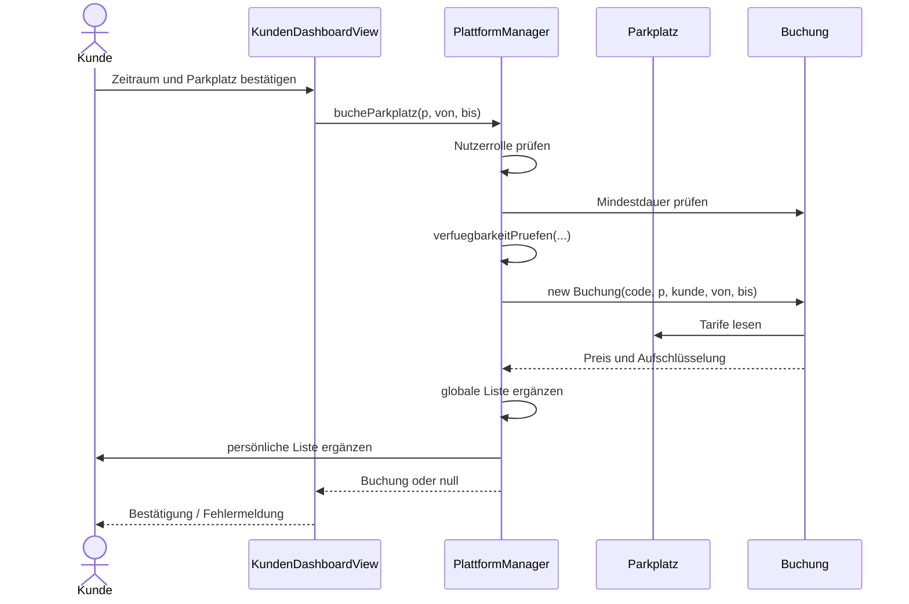

### 3.5 Kommunikationsdiagramm

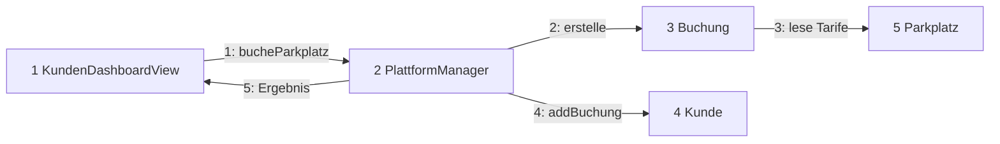

### 3.6 Analyse-Muster

* **Controller/Mediator:** `PlattformManager` bündelt die Anwendungsfälle und
  verhindert, dass die Views direkt die Datenhaltung verändern müssen.
* **Polymorphie:** `Kunde` und `Betreiber` spezialisieren die abstrakte Klasse
  `User`; Rollenprüfungen erfolgen über den konkreten Typ.
* **Facade:** Das Interface `IPlattformManager` stellt den Views eine kleine,
  fachlich relevante Oberfläche zur Verfügung.

## 4. OO-Design

### 4.1 Architektur und Schichtenmodell

Die Anwendung folgt einer vereinfachten MVC-Architektur.

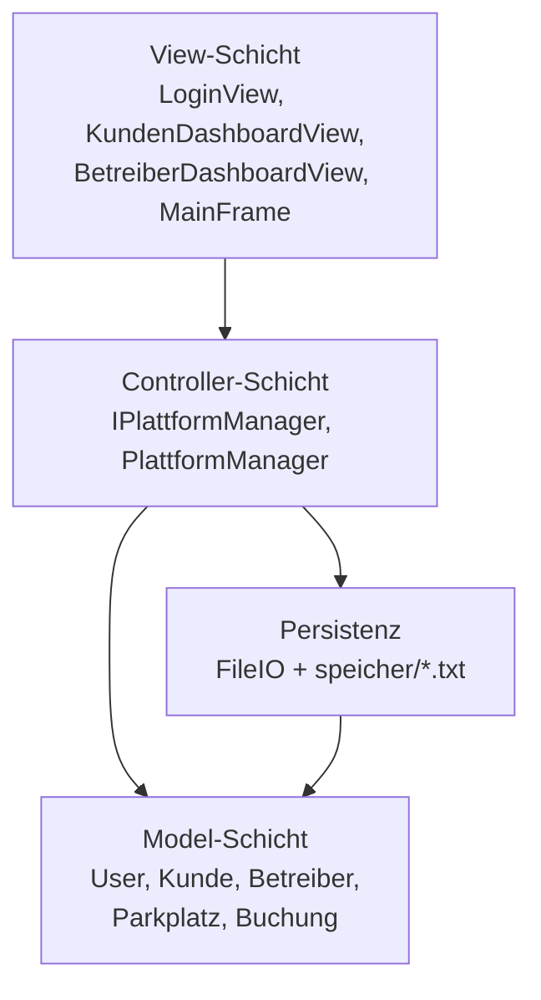

### 4.2 Designklassenmodell

Im Designmodell werden Sichtbarkeiten, Datentypen und zentrale Operationen
konkretisiert.

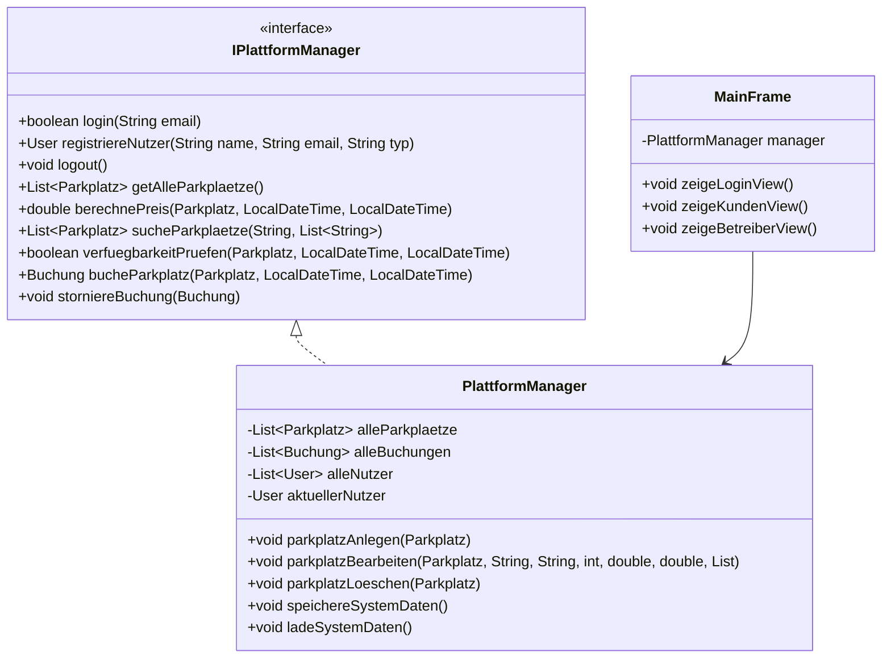

### 4.3 Fachliches Subsystemmodell

| Subsystem | Verantwortliche Klassen | Aufgabe |
|---|---|---|
| Benutzerverwaltung | `User`, `Kunde`, `Betreiber`, `PlattformManager` | Registrierung, Login und Rollen |
| Parkplatzverwaltung | `Parkplatz`, `Betreiber`, `PlattformManager` | Stammdaten und Betreiberrechte |
| Buchungsverwaltung | `Buchung`, `Kunde`, `PlattformManager` | Zeitraum, Kapazität, Preis und Stornierung |
| Präsentation | `MainFrame`, `LoginView`, Dashboard-Views | Interaktion und Navigation |
| Persistenz | `FileIO` | Serialisierung und Laden der Daten |

### 4.4 Entwurfsmuster

| Muster | Verwendung |
|---|---|
| MVC | Trennung von Swing-Views, `PlattformManager` und Modelklassen |
| Facade | `IPlattformManager` reduziert die Kopplung der Views |
| Template/Vererbung | Gemeinsame Eigenschaften in `User`, Spezialisierung durch Rollen |
| Observer-nahe Aktualisierung | Views aktualisieren Tabellen und Karten nach Aktionen über den Manager |

### 4.5 Benutzeroberfläche

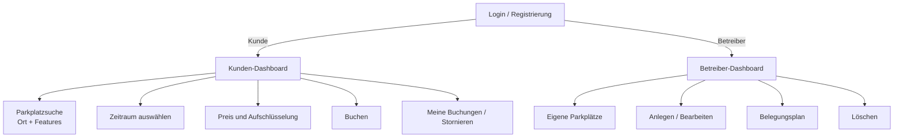

Die GUI verwendet Swing-Komponenten. `MainFrame` ersetzt das aktuelle Panel,
statt für jede Ansicht ein neues Hauptfenster zu öffnen. Die Kundenansicht
enthält Suche, Zeitraumauswahl, Preisvorschau und Buchungstabelle. Die
Betreiberansicht enthält Parkplatzverwaltung und Belegungsübersicht.

## 5. OO-Implementierung

### 5.1 Paketstruktur

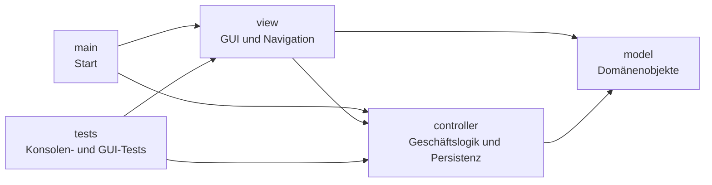

### 5.2 Komponenten- und Verteilungsmodell

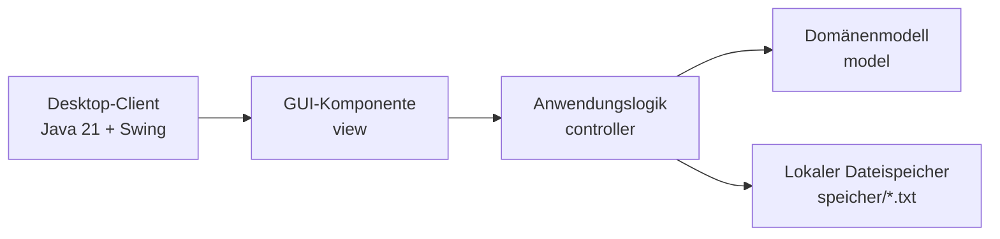

Die Anwendung wird als Desktop-Anwendung auf einem Rechner ausgeführt. Eine
separate Server- oder Datenbankkomponente ist im aktuellen Stand nicht
vorhanden. `FileIO` serialisiert die Objektlisten in lokale Dateien.

### 5.3 Persistenz und Referenzintegrität

Beim Start lädt `Start` die Daten über `PlattformManager.ladeSystemDaten()`.
Beim Beenden speichert ein Shutdown-Hook die Daten. Nach dem Laden werden
Buchungsreferenzen anhand der Parkplatz-ID wieder mit den geladenen
`Parkplatz`-Objekten verbunden. Dadurch verweist eine Buchung nicht auf ein
isoliertes Duplikat, sondern auf das Objekt aus der zentralen Parkplatzliste.

### 5.4 Wichtige Implementierungsregeln

* Ein Kunde muss eingeloggt sein, um zu buchen.
* Ein Betreiber darf keine Buchung stornieren.
* Die Mindestbuchungsdauer beträgt 15 Minuten.
* Zeiträume mit `bis == von` oder einer späteren Startzeit werden nicht als
  überlappend gezählt; Anschlussbuchungen sind damit möglich.
* Wochenenden und die hinterlegten Berliner Feiertage verwenden den
  Sondersatz.
* Der Buchungspreis wird bei Erstellung gespeichert und bleibt danach stabil.
* Ein Parkplatz mit bestehenden Buchungen darf nicht gelöscht werden.

## 6. Validierung und Fazit

### 6.1 Durchgeführte Tests

Die Klasse `tests.PlattformManagerTest` prüft die zentralen fachlichen Abläufe:

| Testbereich | Erwartetes Ergebnis |
|---|---|
| Registrierung und doppelte E-Mail | Duplikat wird abgelehnt |
| Login | Gültige E-Mail erfolgreich, unbekannte E-Mail erfolglos |
| Verfügbarkeit | Leerer, voller, anschließender und überlappender Zeitraum korrekt |
| Buchen und Stornieren | Rollen- und Eigentümerregeln werden eingehalten |
| Preise | Preis und Aufschlüsselung werden erzeugt |
| Betreiberverwaltung | Anlegen, Bearbeiten und Löschen ohne Buchung möglich |
| Featuresuche | Alle geforderten Features müssen vorhanden sein |

`tests.PersistenceTest` prüft das Speichern und Laden von Nutzern,
Parkplätzen und Buchungen sowie die Referenzintegrität zwischen Buchung und
Parkplatz. `tests.KundenDashboardViewTest` prüft den Aufbau der
Kundenoberfläche und einen einfachen Suchablauf.

### 6.2 Vergleich von Designmodell und Implementierung

| Designaussage | Implementierung | Bewertung |
|---|---|---|
| Rollen über `User`-Spezialisierungen | `Kunde` und `Betreiber` erweitern `User` | umgesetzt |
| Zentraler Controller | `PlattformManager` implementiert die Anwendungsfälle | umgesetzt |
| Lose Kopplung der Views | `IPlattformManager` wird von `LoginView` genutzt | teilweise umgesetzt |
| Dateibasierte Persistenz | `FileIO` und `speicher/*.txt` | umgesetzt |
| Betreiber-Belegungsplan | View ist vorhanden | fachliche Abfrage noch zu ergänzen |
| Vollständige Betreiber-Buchungsabfrage | `getZukuenftigeBuchungenFuerBetreiber` liefert aktuell `null` | offen |

### 6.3 Offene Punkte und technische Schulden

Die folgende Abweichung ist bei der weiteren Umsetzung zu berücksichtigen:

* `PlattformManager.getZukuenftigeBuchungenFuerBetreiber(Betreiber)` ist im
  aktuellen Stand noch nicht implementiert und liefert `null`. Für eine
  vollständig funktionsfähige Belegungsansicht muss die Methode Buchungen der
  vom Betreiber verwalteten Parkplätze filtern und auf zukünftige Zeiträume
  begrenzen.

Darüber hinaus sind die vorhandenen Tests einfache `main`-Programme und keine
JUnit-Tests. Für eine spätere Qualitätssicherung empfiehlt sich die
Überführung der fachlichen Tests in automatisierte Testfälle.

### 6.4 Fazit

Das System deckt die wesentlichen Geschäftsprozesse eines
Parkplatz-Management-Systems ab. Das Analysemodell lässt sich konsistent auf
die vorhandenen Klassen und Pakete abbilden. Besonders klar erkennbar sind die
Rollenmodellierung, die zentrale Steuerung durch `PlattformManager`, die
Trennung der Swing-Views vom Domänenmodell und die Persistenz über `FileIO`.

Die wichtigste noch offene Design-zu-Implementierung-Lücke ist die Abfrage
zukünftiger Betreiberbuchungen. Nach deren Implementierung und der
Automatisierung der Tests entspricht die Lösung auch für die
Betreiber-Belegungsansicht vollständig dem beschriebenen Modell.
